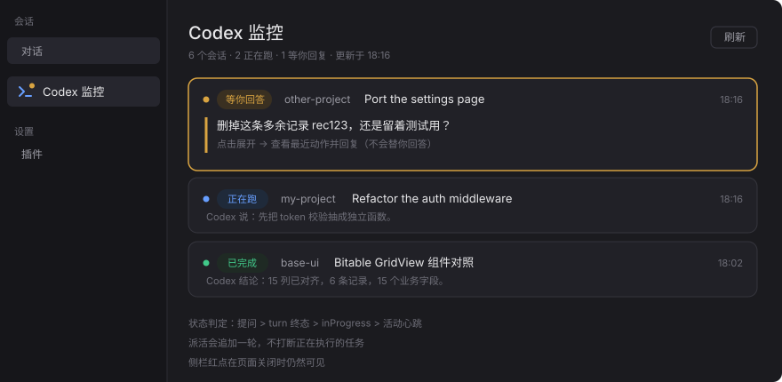

# codex-monitor

Watch and drive the **Codex desktop app** on your machine — from a DSH sidebar panel, or
from the command line.

Codex runs long tasks in several windows at once. This tool answers three questions without
you switching between them: which sessions are still running, what each one is doing right now,
and — the one that actually bites — **which one is blocked waiting for your answer**.

It can also send work into any existing session, or start a new one.



## Two front ends, one implementation

| | |
|---|---|
| **DSH plugin** (`plugin/`) | A left-sidebar entry with a live badge, plus a full page listing every session. No terminal needed. |
| **CLI** (`codex_ctl.py`) | The same data as text/JSON, for scripting and for agents. |

Both are thin adapters over `codex_ctl.py`. That is deliberate: an earlier version kept two
copies of the liveness logic and they drifted apart, so the UI and the CLI disagreed about
whether the same session was running. There is now exactly one implementation, and the plugin
prefers the repo-root script when it is present.

## Why this exists

Codex's own status fields are not trustworthy for this:

- The desktop app persists an **in-flight turn as `interrupted`**, so `turn.status` says
  "stopped" while the agent is happily running.
- The `inProgress` flag in `thread_history_1.sqlite` **lags by minutes**.

Using either alone gives wrong answers, so `live_state` weighs them in a deliberate order:

1. **A pending question wins** — Codex has genuinely stopped, whatever the timestamps say.
2. **A terminal `turn.status`** (`completed` / `failed`) is final — no heartbeat can override it.
   This ordering matters: in practice almost every completed turn has its last activity well
   under the heartbeat window, so letting the heartbeat win would report finished work as
   still running.
3. **`inProgress`** means running.
4. Only `interrupted`/unknown falls back to the **activity heartbeat**, with a deliberately wide
   window: long commands and sub-agents routinely go quiet for minutes without being stuck.

## The DSH plugin

### Install

```bash
# from the repo root
dsh plugin install ./plugin
```

Then enable **Codex monitor** in Settings → Plugins and restart the app. A terminal-style icon
appears in the left sidebar.

### What it does

- **Sidebar badge** — a dot appears while any session is waiting for you. It keeps working when
  the panel is closed, because the badge styles live in `document.head`, not in the page tree.
- **Waiting count in the label** — screen readers cannot see the glyph (the sidebar marks icon
  subtrees `aria-hidden`), so the count is also carried in the row's accessible label.
- **Session list** — state, project, title, latest action, and the pending question inline.
  Waiting sessions sort to the top and get a warning-coloured border.
- **Detail on expand** — model, directory, thread id, and the last few actions.
- **Reply / dispatch** — type into the box, press Send. Options Codex offered are listed as
  buttons that *fill the box*; they never send on their own.
- **Polling** — every 5s while something is running or you are typing, otherwise every 30s;
  paused while the tab is hidden, and aborted on unmount.

### Design notes

- **Dispatch appends a turn.** It does not interrupt whatever is running; the message queues.
- **The plugin does not answer for you.** It surfaces options so you can decide.
- **Sends are confirmed, not assumed.** The host waits for the real result and returns 502 with
  Codex's error if the turn was refused — the draft stays in the box. An earlier version
  fire-and-forgot the request, so a failed send still showed a green success and cleared what
  you had typed.
- **One resident `codex_ctl.py serve` child per app run.** This is load-bearing, not an
  optimisation: an app-server dies with the process that spawned it, and Codex marks the
  in-flight turn `interrupted` on the way out. Spawning one process per request killed every
  dispatched turn within ~100 ms, so the work silently never ran. Keeping one app-server alive
  across requests is what makes dispatch actually work.

## CLI

```bash
python3 codex_ctl.py list                       # who is running, who is waiting
python3 codex_ctl.py status --thread ID         # what one session is stuck on
python3 codex_ctl.py watch                      # follow along, print only changes
python3 codex_ctl.py watch --once               # single snapshot
python3 codex_ctl.py send --thread ID --message "keep going" --wait 120
python3 codex_ctl.py new --cwd ~/proj --message "run the tests" --wait 300
python3 codex_ctl.py serve                      # long-lived JSON server used by the plugin
```

`list --json`, `status --json`, and `send --json` emit machine-readable output. `send --json`
reports refusal as `{"ok": false, "error": ...}` on a non-zero exit, which is what lets the UI
tell a real dispatch from a failed one.

Sample `list` output:

```
本机 Codex 会话 6 个 · 正在跑 3 · 等你回复 1

▶ 正在跑      18:16  my-project          Refactor the auth middleware
                  id=01a1f73d-de97-7ca1-9831-e5973f9772cf
❓ 等你答      18:16  other-project       Port the settings page
                  ↳ Delete the stray record rec123, or keep it for testing?
                  id=01a1f73c-cd9d-76a3-be71-ad484f137417
```

## How it works

Two channels, because neither is sufficient alone:

| Channel | Source | Used for |
|---|---|---|
| Control | `codex app-server` over JSON-RPC stdio | listing sessions, sending turns, turn status |
| Telemetry | `~/.codex/thread_history_1.sqlite` | live actions: commands run, files changed, sub-agents, heartbeat |

Both read the same `~/.codex` store the desktop app uses, so what you see here is what you see
in the Codex window.

### Why not `codex app-server proxy`

`proxy` attaches to the shared daemon, but it fails with `Broken pipe` when the CLI and the
desktop app bundle different Codex versions (e.g. CLI 0.167 vs. bundled 0.171). Each long-lived
server therefore spawns its own `app-server --listen stdio://`. It shares the same store and can
append to the same thread; the cost is roughly 2 seconds of startup, paid once per app run.

Because that app-server holds a writer lock on a thread it is driving, a CLI `send` to the same
thread while the panel is open fails with `already has an active writer`. Use the panel, or
close it first.

## Requirements

- macOS with the Codex desktop app (or the `codex` CLI) installed and logged in
- Python 3.8+ (standard library only, no dependencies)
- For the panel: a DSH desktop build with the web UI

## Tests

```bash
python3 -m unittest discover -s tests -v   # 19 tests, no Codex needed
node plugin/verify-ui.mjs                  # renders the panel from a fixture payload
```

The Python suite builds throwaway SQLite fixtures shaped like Codex's own tables and covers the
liveness ordering, question detection, and item parsing. It never launches Codex.

`verify-ui.mjs` is an offline render harness, not a browser test: it proves the module factory
registers its slots and that the page turns a payload into the expected copy. It cannot confirm
visual layout.

## Layout

```
codex_ctl.py          # the implementation: CLI, JSON, and the resident server
plugin/               # the DSH plugin (host + client halves)
  index.js            #   spawns codex_ctl.py serve, proxies HTTP routes
  client.js           #   sidebar entry + panel page
  locale/             #   Plugin Manager copy (zh/en)
sync-plugin.sh        # mirrors codex_ctl.py into plugin/ for standalone installs
```

## Known limits

- `send` **appends a turn**; it does not interrupt a running one. Messages queue behind it.
- Read and dispatch only. Sessions are never deleted and Codex config is never modified.
- It will not answer Codex's questions for you — options are surfaced, you decide.
- Status reflects Codex's local store; sessions driven from another machine's daemon will not
  appear.
- The panel's visual layout has not been verified in a real browser; only the data path and the
  rendered component tree have been checked.

## Using it as a DSH skill

The `SKILL.md` in this repo registers the CLI as a [DeepSeek Harness](https://github.com/deepseek-ai)
skill so an agent can call it directly. Copy the directory to `~/.agents/skills/codex-monitor/`.

## License

MIT
